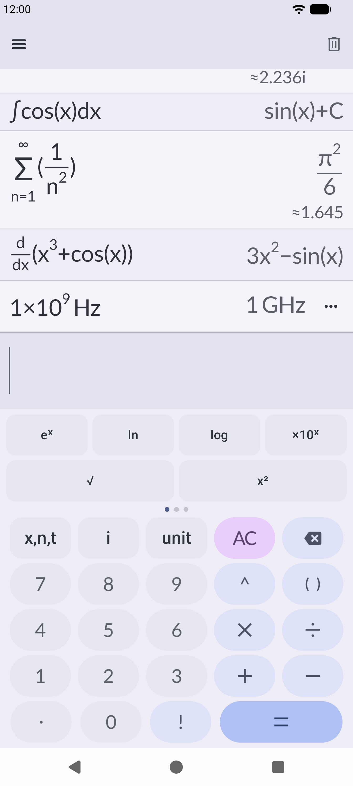
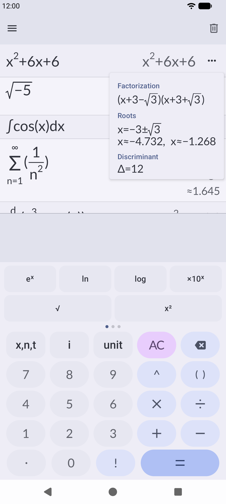
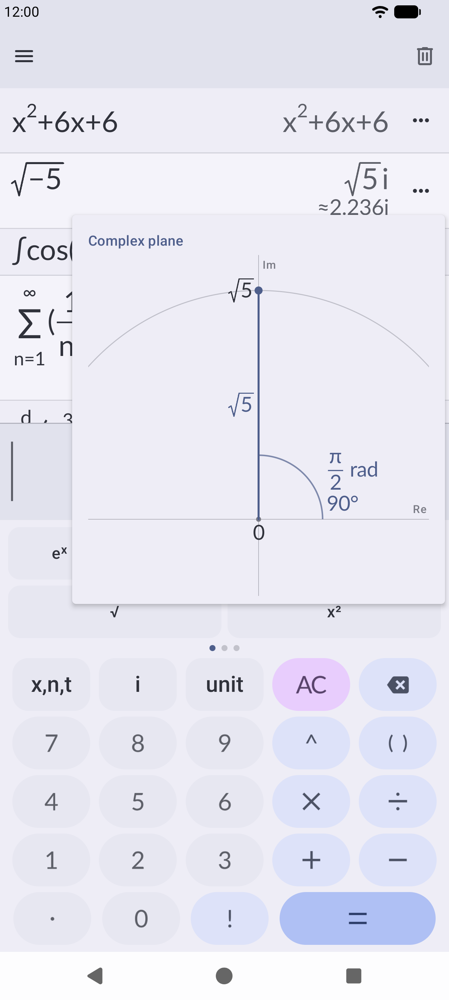
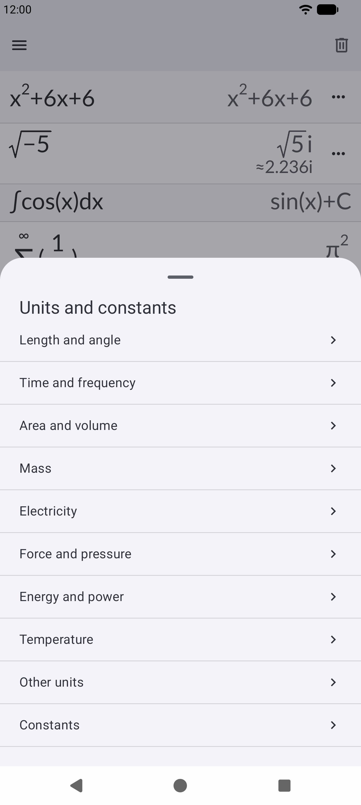

# Pascaline

A calculator for Android inspired by graphing calculators like the NumWorks. Named after the
Pascaline, the mechanical calculator Blaise Pascal built in 1642.

  
  
  
  

## Features

- **Natural input**: powers, indices, fractions, square roots and integral bounds are typed in
  boxes, the way they are written on paper
- **Exact answers** next to approximations: `√(−5) = √5i ≈ 2.236i`, `Σ 1/n² = π²/6`
- **Algebra**: polynomials are expanded and factorized, with their roots and discriminant
- **Calculus**: symbolic derivatives and integrals (`∫cos(x)dx = sin(x)+C`), definite integrals,
  sums and products, including infinite ones
- **Complex numbers** with a complex plane showing modulus, argument, real and imaginary parts
- **Number info**: decimal, hexadecimal, binary and prime factors of integers
- **Units and constants**: results in the easiest unit to read (`10⁹ Hz = 1 GHz`), with the value
  in SI units in the `…` menu
- **History** that scrolls, with swipe to delete
- **No internet permission**: everything is computed on the device

## Credits

Pascaline is based on [Unitto](https://github.com/sadellie/unitto) by Elshan Agaev. Thanks for
building the foundation this app grew from. Pascaline is not affiliated with or endorsed by
Unitto.

## License

Pascaline is free software under the [GNU General Public License v3.0](./LICENSE), like Unitto.
Files changed from Unitto keep their original copyright notice next to the new one.
