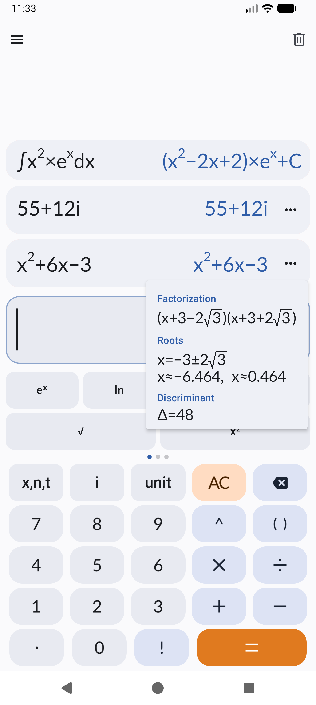
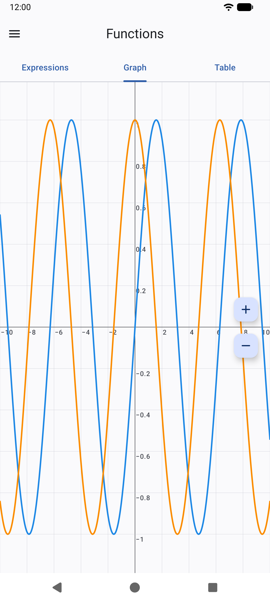
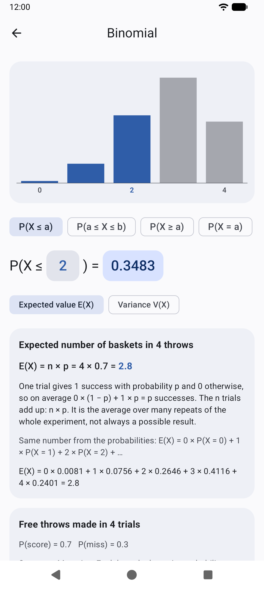
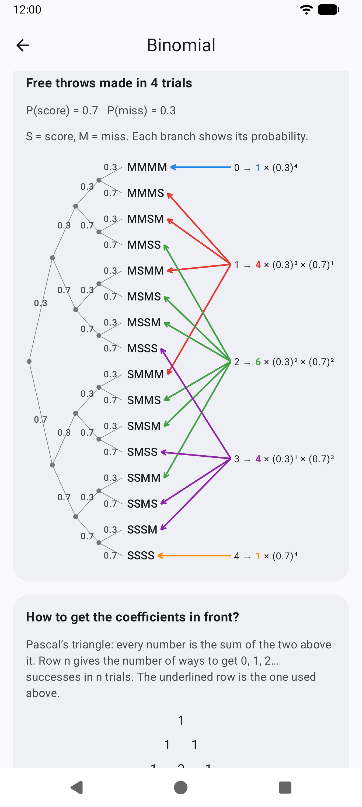

# Pascaline

A calculator for Android. Named after the Pascaline, the mechanical calculator Blaise Pascal built in 1642.

  
  
  
  

## Features

### Calculator

- **Natural input**: powers, fractions, roots and integral bounds are typed in boxes, the way they
  are written on paper
- **Exact answers** next to approximations: `√(−5) = √5i ≈ 2.236i`, `Σ 1/n² = π²/6`
- **Calculus**: symbolic derivatives and antiderivatives, including integration by parts and
  partial fractions (`∫x²eˣdx = (x²−2x+2)eˣ+C`), definite integrals, sums and products, including
  infinite ones
- **Algebra**: expressions are simplified and polynomials expanded and factorized, with their
  roots and discriminant
- **Complex numbers** with a complex plane showing modulus, argument, real and imaginary parts
- **Units and constants**: results in the easiest unit to read (`10⁹ Hz = 1 GHz`)
- **Number info**: decimal, hexadecimal, binary and prime factors of integers

### Functions

- Expressions, Graph and Table pages, like the NumWorks Functions app
- Several functions in their own colors, zoom with buttons or by pinching one axis at a time

### Probability

- Ten laws: binomial, uniform, exponential, normal, chi-squared, Student, geometric, Poisson,
  Fisher and hypergeometric
- Type a, b or the probability right inside `P(X ≤ a) = p`: entering a probability finds the
  bound, and for discrete laws it gives the closest probability that can actually be reached
- **Expected value and variance** of every law, with the formula, your values and why it holds
- **Binomial explained**: a probability tree of coin flips or free throws, colored arrows from each
  number of successes to its outcomes, and Pascal's triangle for the coefficients

### And also

- Unit converter, date calculator, time zones and body mass index from Unitto
- **No internet permission**: everything is computed on the device

## Credits

Pascaline is based on [Unitto](https://github.com/sadellie/unitto) by Elshan Agaev. Thanks for
building the foundation this app grew from. Pascaline is not affiliated with or endorsed by
Unitto.

## License

Pascaline is free software under the [GNU General Public License v3.0](./LICENSE), like Unitto.
Files changed from Unitto keep their original copyright notice next to the new one.
