

  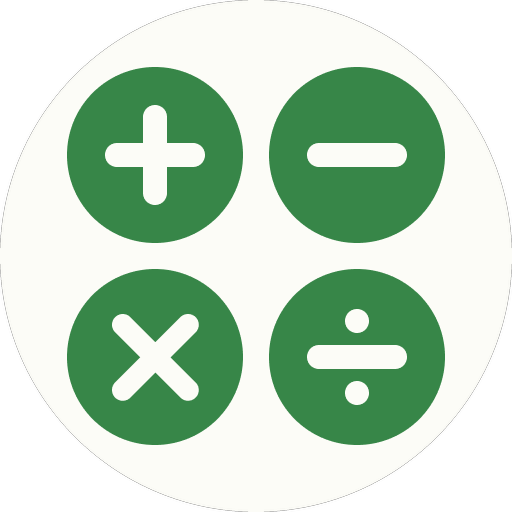

<h1 align="center">Pascaline</h1>

  A calculator for Android and the web. 
  Named after the Pascaline, the mechanical calculator Blaise Pascal built in 1642.

  &nbsp;&nbsp;

## 📲 Install

<table>
  <tr>
    <th width="33%">Android app</th>
    <th width="33%">Web app on Android</th>
    <th width="33%">Web app on iPhone &amp; iPad</th>
  </tr>
  <tr valign="top">
    <td>
      1. Download the <code>.apk</code> from the
      <a href="https://github.com/Calculator-Pascaline/Pascaline/releases/latest">latest release</a> 
      2. Open it, and allow the install if Android asks 
      3. Tap <b>Install</b>
    </td>
    <td>
      1. Open the <a href="https://calculator-pascaline.github.io/Pascaline/">web app</a> in Chrome 
      2. Tap <b>⋮</b>, then <b>Add to Home screen</b> 
      3. Choose <b>Install</b>
    </td>
    <td>
      1. Open the <a href="https://calculator-pascaline.github.io/Pascaline/">web app</a> in Safari 
      2. Tap <b>Share</b> (the square with an arrow) 
      3. Choose <b>Add to Home Screen</b>, then <b>Add</b>
    </td>
  </tr>
</table>

Added to the home screen, the web app opens in its own window and works without internet.

## ✨ Features

### 🏠 Every tool on one screen

<table>
  <tr>
    <td align="center" valign="top" width="33%">
      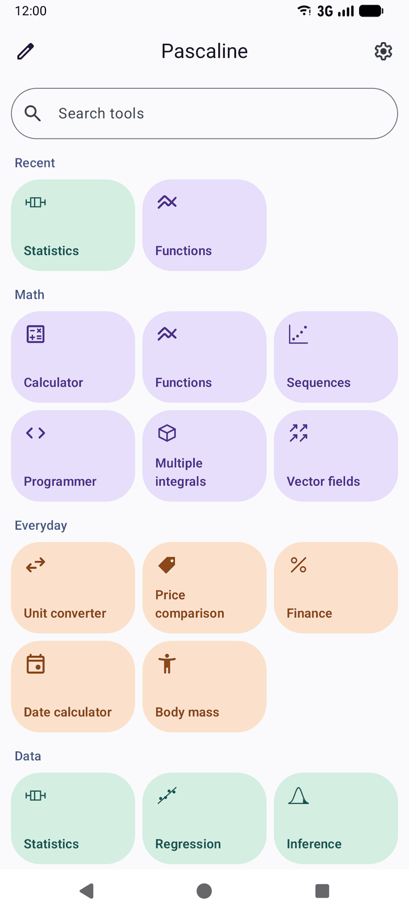 
    </td>
    <td valign="top">
      Home lists every tool, grouped by topic: <b>Math</b>, <b>Everyday</b>, <b>Data</b>, <b>Science</b> and <b>Electronics</b>.  
      Search a tool by its name, or find the ones you used last at the top.  
      In the edit mode, rename, move and add sections, drag tools to change their place, move them to another section, and hide the ones you don't need.
    </td>
  </tr>
</table>

### 🧮 Advanced math

<table>
  <tr>
    <td align="center" valign="top" width="33%">
      <b>Complex numbers</b> 
      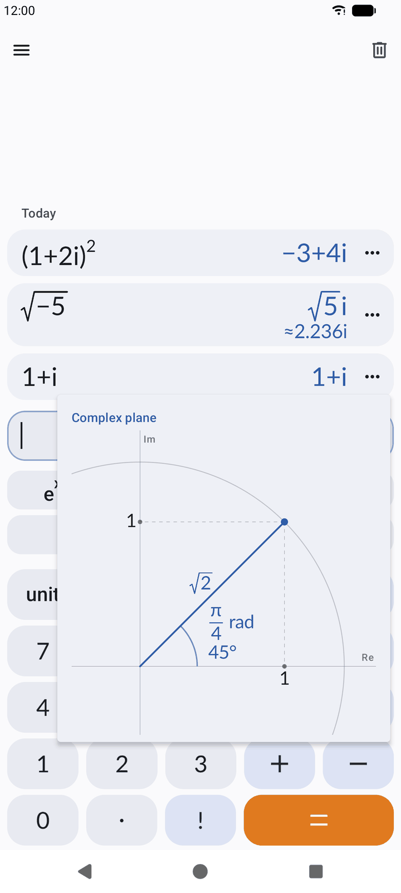 
      Exact results and the complex plane
    </td>
    <td align="center" valign="top" width="33%">
      <b>Calculus</b> 
      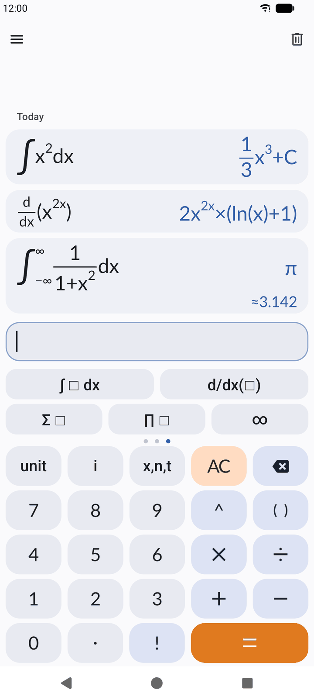 
      Integrals, even to infinity, and derivatives
    </td>
    <td align="center" valign="top" width="33%">
      <b>Series</b> 
      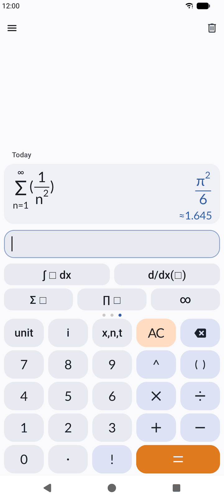 
      Sums and products, with exact values
    </td>
  </tr>
</table>

### 📐 Algebra and functions

<table>
  <tr>
    <td align="center" valign="top" width="33%">
      <b>Equations</b> 
      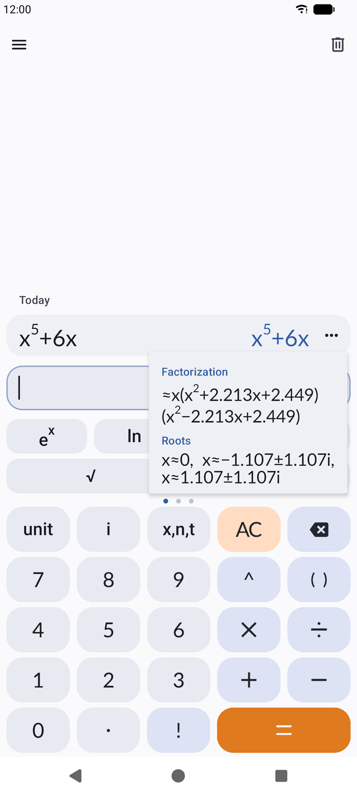 
      Factorization and all the roots
    </td>
    <td align="center" valign="top" width="33%">
      <b>Functions</b> 
      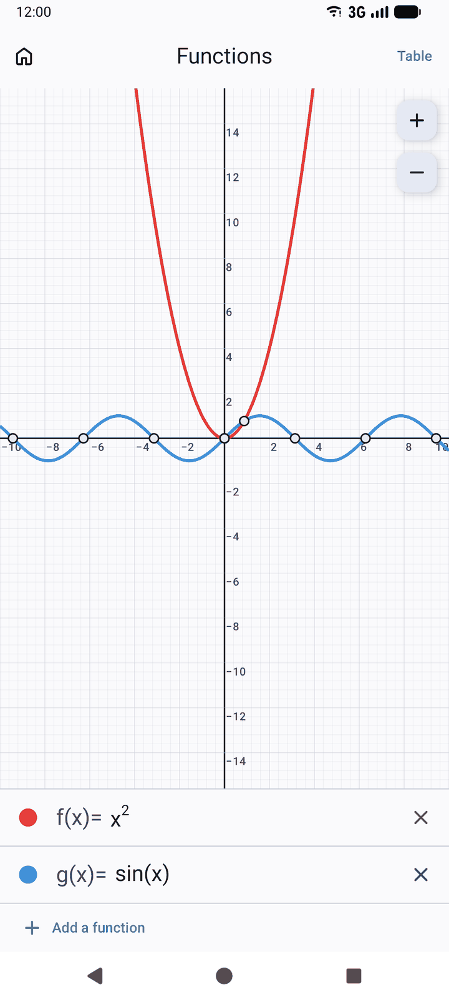 
      Graphs, zeros, derivatives and tangents
    </td>
    <td align="center" valign="top" width="33%">
      <b>Programmer</b> 
      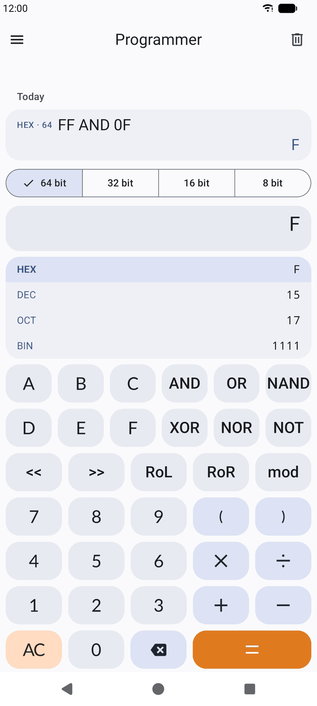 
      HEX, DEC, OCT and BIN with bitwise operators
    </td>
  </tr>
</table>

### 🧊 In 3D and in the plane

<table>
  <tr>
    <td align="center" valign="top" width="50%">
      <b>Multiple integrals</b> 
      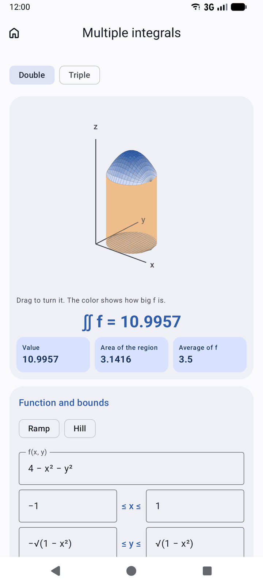 
      Double and triple integrals in 3D you turn with a finger, with bounds that depend on x and y
    </td>
    <td align="center" valign="top" width="50%">
      <b>Vector fields</b> 
      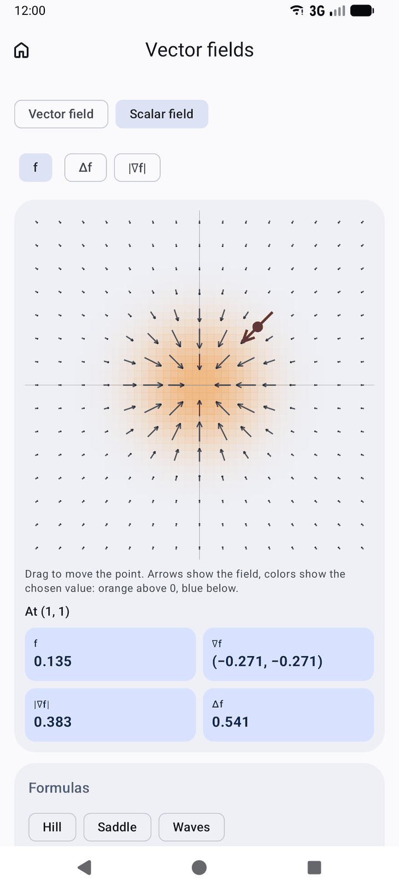 
      Fields as arrows, with gradient, divergence, rotation and Laplacian at any point
    </td>
  </tr>
</table>

### 📊 Data

<table>
  <tr>
    <td align="center" valign="top" width="33%">
      <b>Statistics</b> 
      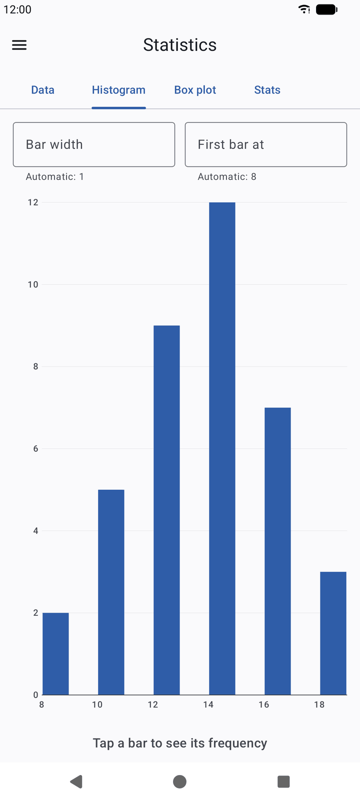 
      Histograms, box plots and every statistic
    </td>
    <td align="center" valign="top" width="33%">
      <b>Regression</b> 
      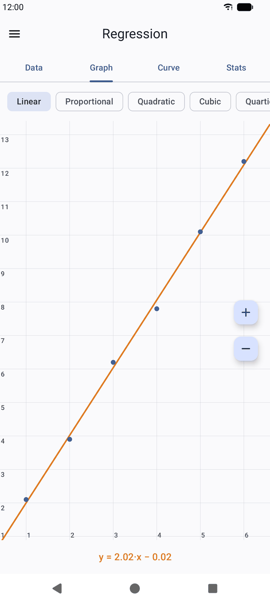 
      Drag your points, the best curve follows
    </td>
    <td align="center" valign="top" width="33%">
      <b>Inference</b> 
      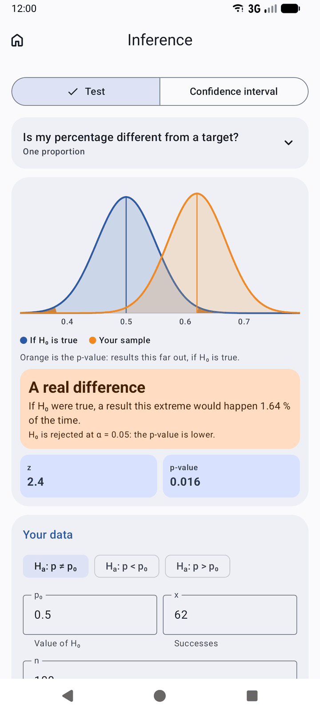 
      Tests and intervals, with both distributions and a plain answer
    </td>
  </tr>
  <tr>
    <td align="center" valign="top" width="33%">
      <b>Probability</b> 
      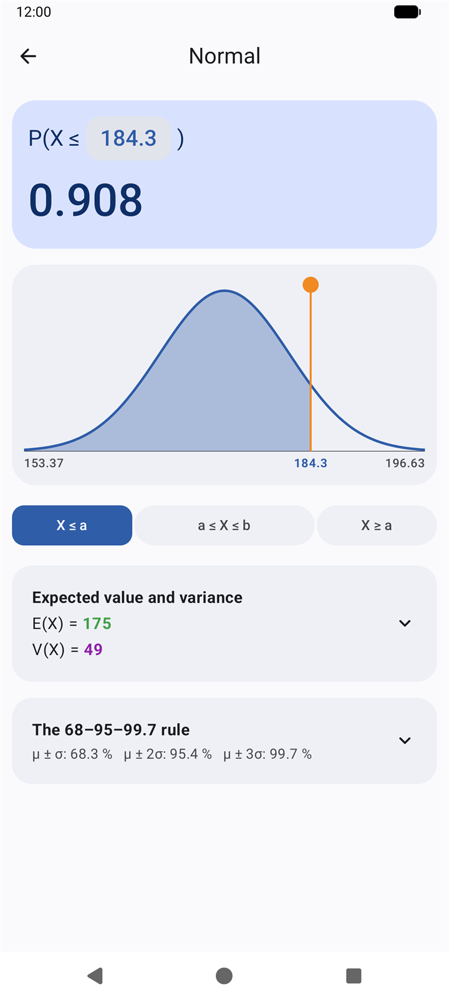 
      Drag the graph to get the probability, with examples
    </td>
    <td></td>
    <td></td>
  </tr>
</table>

### 🔭 Science

<table>
  <tr>
    <td align="center" valign="top" width="33%">
      <b>Sky and Earth</b> 
      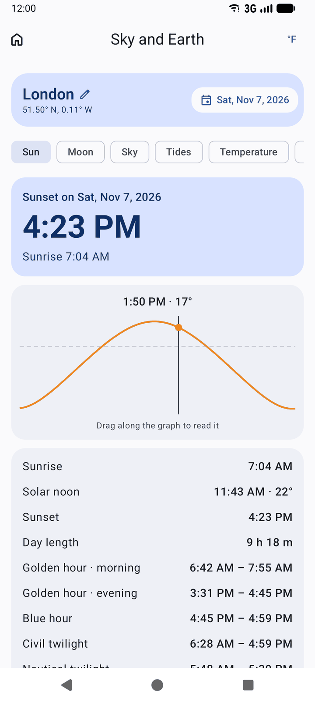 
      Sun, moon, sky, tides, temperature and rain for any city, offline
    </td>
    <td align="center" valign="top" width="33%">
      <b>Projectile</b> 
      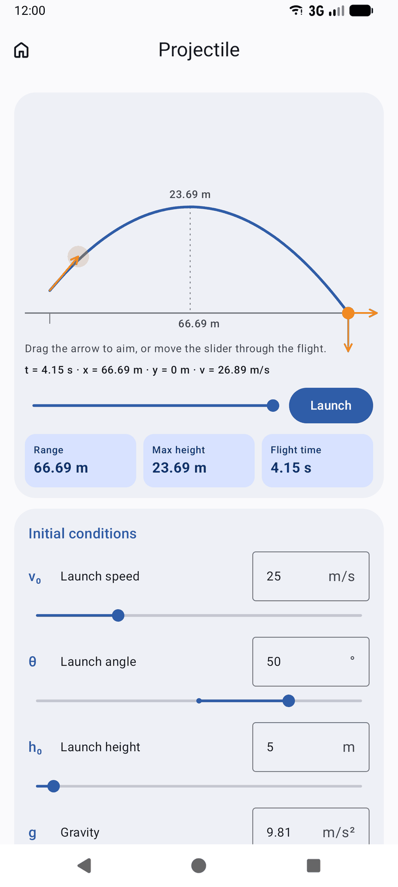 
      An animated throw, with air, and how it is calculated
    </td>
    <td align="center" valign="top" width="33%">
      <b>Elements</b> 
      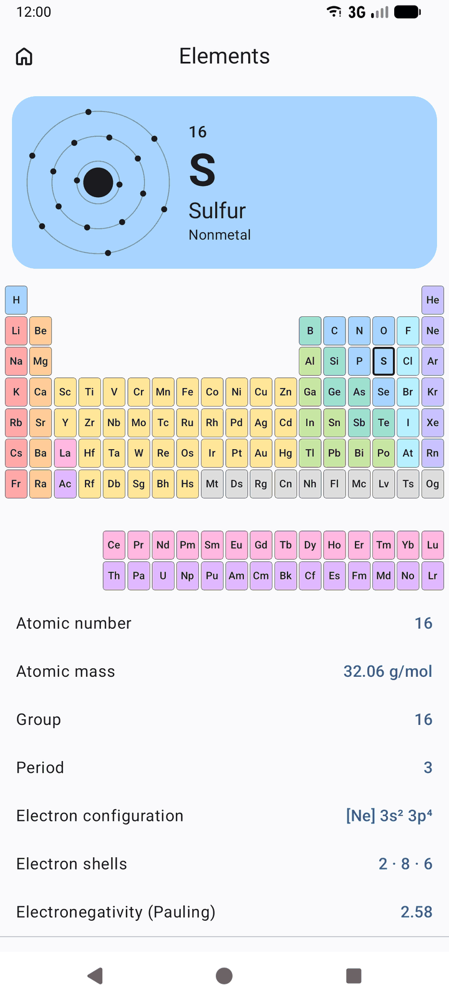 
      The periodic table, with an animated atom
    </td>
  </tr>
</table>

### ⚡ Electronics

<table>
  <tr>
    <td align="center" valign="top" width="33%">
      <b>Filters</b> 
      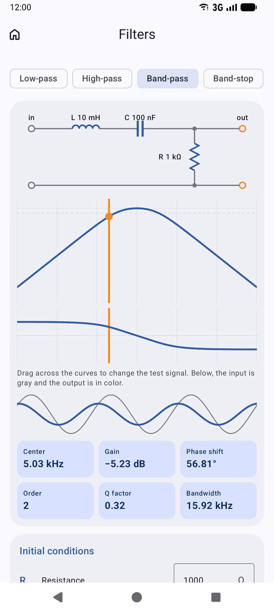 
      RC, RL and RLC filters with their circuit and Bode plot
    </td>
    <td align="center" valign="top" width="33%">
      <b>Charging</b> 
      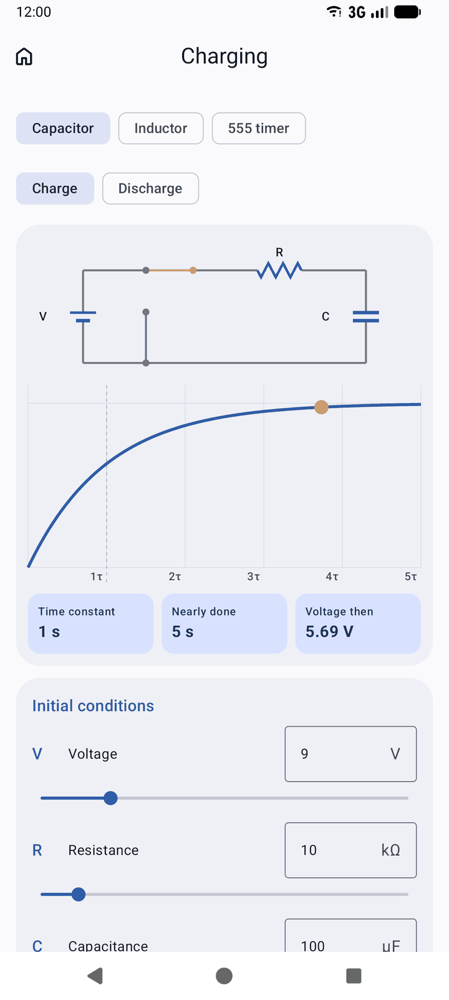 
      Capacitors, coils and the 555 timer
    </td>
    <td align="center" valign="top" width="33%">
      <b>Resistor colors</b> 
      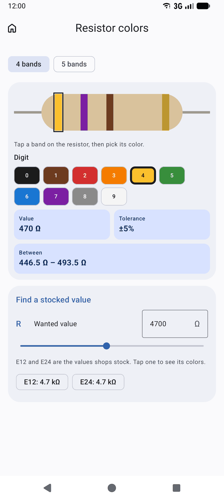 
      Read the bands, or find a standard value
    </td>
  </tr>
</table>

### 🧰 Everyday tools

<table>
  <tr>
    <td align="center" valign="top" width="33%">
      <b>Unit converter</b> 
      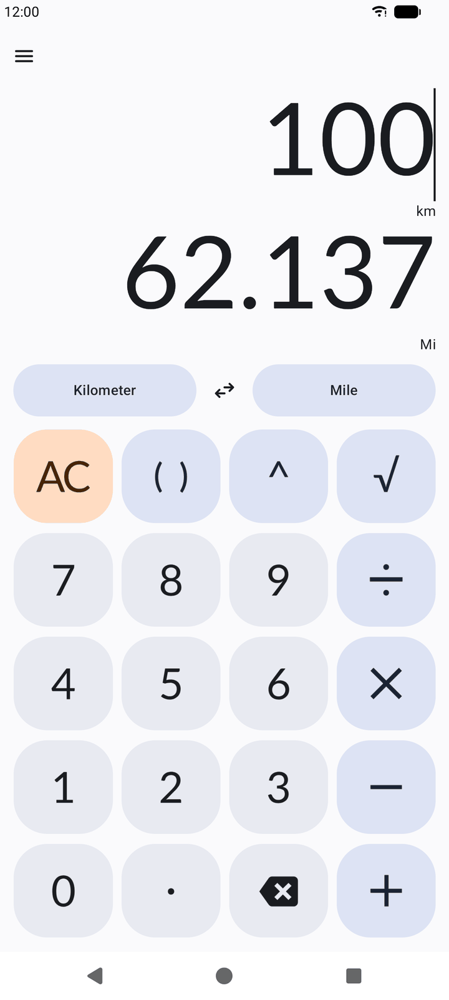 
      Convert between all sorts of units
    </td>
    <td align="center" valign="top" width="33%">
      <b>Finance</b> 
      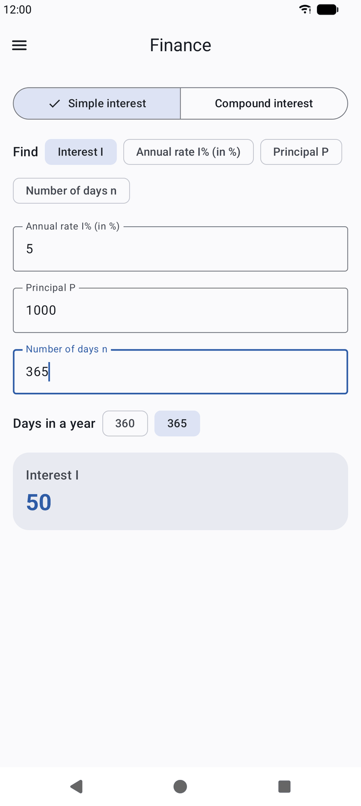 
      Loans, savings, and simple and compound interest
    </td>
    <td align="center" valign="top" width="33%">
      <b>And more</b> 
      Sequences, Orbits, Logic gates, Price comparison, Date calculator and Body mass
    </td>
  </tr>
</table>

## 🔒 Privacy

The Android app doesn't ask for the internet permission, so it can't connect to the internet: your calculations stay on your device. Links like **Report an issue** open in your browser.

The web app is downloaded from GitHub Pages, then everything you do in it stays in your browser.

## 💬 Feedback

Ideas, bugs or anything that could make Pascaline better are welcome.

  

## 🙏 Credits

Pascaline is based on [Unitto](https://github.com/sadellie/unitto) by Elshan Agaev. Thanks for building the foundation this app grew from. Pascaline is not affiliated with or endorsed by Unitto.

How much comes from each, as of version 1.6.0, in lines of Kotlin code. Only real code is counted: license headers, blank lines, comments, the bundled math library (`kt-math`), the icon drawings and the translations are left out.

| | From Unitto | From Pascaline |
|---|---|---|
| All code | 27,339 lines (45.6%) | 32,560 lines (54.4%) |
| Calculator and its tools | 1,487 lines (6.7%) | 20,629 lines (93.3%) |
| Math engine | 572 lines (11.0%) | 4,624 lines (89.0%) |

Unitto's code is mostly the base underneath: storage, settings, the unit converter and the home screen widget. The calculator, its math engine and the tools are mostly Pascaline's. Each line is counted for whoever wrote it (`git blame -w -M -C`): a Unitto line that was only reformatted or moved still counts as Unitto's.

## 📄 License

Pascaline is free software under the [GNU General Public License v3.0](./LICENSE), like Unitto. Files changed from Unitto keep their original copyright notice next to the new one.
